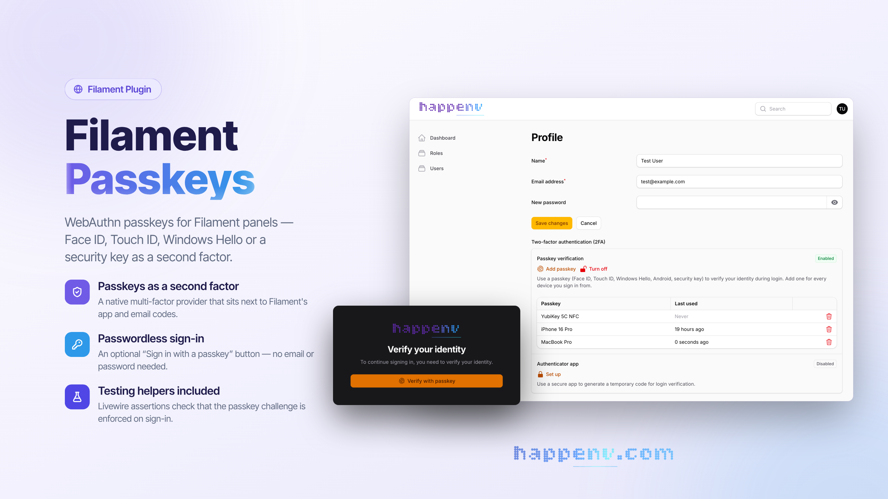

# Filament Passkeys

<div class="filament-hidden">



</div>

[](https://github.com/happenv-com/filament-passkeys/releases)
[](https://github.com/happenv-com/filament-passkeys/actions/workflows/tests.yml)
[](https://github.com/happenv-com/filament-passkeys/actions/workflows/phpstan.yml)
[](https://github.com/happenv-com/filament-passkeys/actions/workflows/quality.yml)
[](https://packagist.org/packages/happenv-com/filament-passkeys)
[](LICENSE.md)

Multi-factor authentication for Filament panels using WebAuthn passkeys, powered by [`laravel/passkeys`](https://github.com/laravel/passkeys-server).

```php
use Happenv\FilamentPasskeys\FilamentPasskeysPlugin;
use Happenv\FilamentPasskeys\PasskeyAuthentication;

$panel
    ->multiFactorAuthentication([
        PasskeyAuthentication::make(),
    ])
    // Optional: a "Sign in with a passkey" button on the login page.
    ->plugin(FilamentPasskeysPlugin::make());
```

## Key features

- **Passkeys as a second factor.** A native Filament multi-factor provider: after the password step, users confirm with one of their passkeys. It sits alongside Filament's app and email code providers, and users choose between the methods they have turned on.
- **Passwordless sign-in on the login page.** An optional "Sign in with a passkey" button under the login form signs users in with a discoverable credential, no email or password needed.
- **A passkey for every device.** Users can register as many passkeys as they need (Windows Hello, an Android phone, iCloud Keychain, a security key) and remove any one of them from a table on their Filament profile page. Each row shows which authenticator holds the passkey and when it was last used.
- **A streamlined passkey-only challenge.** When a passkey is a user's only method, the prompt opens as soon as the challenge appears and Filament's redundant "Confirm sign in" button is hidden. Both are on by default and can be turned off.
- **Secure by default.** Challenges are single use and bound to the user who passed the password step, so a replayed assertion or someone else's passkey is rejected. Passwordless sign-in honours `laravel/passkeys` login authorization and `FilamentUser::canAccessPanel()`.
- **Built on `laravel/passkeys`.** Its actions handle challenge generation, verification and storage, and every ceremony runs through Livewire, so no extra routes are exposed.
- **Related origins.** Panels on other domains (e.g. customer domains) can share one RP ID: the package serves the `/.well-known/webauthn` file from the list of origins your app supplies, accepts the same origins on the server, and falls back gracefully in browsers without support.
- **Testing helpers.** Livewire assertions check whether signing in stops at the multi-factor challenge and whether that challenge offers a passkey.
- **Upgrade path from `spatie/laravel-passkeys`.** A migration converts existing passkeys to the `laravel/passkeys` schema.
- **Translated** into [every language Filament supports](#supported-languages) (64 locales).
- **Tested.** A Pest suite runs real WebAuthn ceremonies against a virtual authenticator on every supported PHP, Laravel and Filament combination.

## Requirements

| Package            | Versions                                  |
|--------------------|-------------------------------------------|
| PHP                | ^8.2 (CI runs 8.3 – 8.5)                  |
| Laravel            | 12, 13                                    |
| Filament           | 4 (`^4.13.3`), 5 (`^5.8`)                 |
| `laravel/passkeys` | `^0.3`                                    |

## Installation

Install the package via Composer:

```bash
composer require happenv-com/filament-passkeys
```

Publish and run the migrations from `laravel/passkeys`:

```bash
php artisan vendor:publish --tag="passkeys-migrations"
php artisan migrate
```

Publish the `laravel/passkeys` config (optional, to tweak the relying party ID, allowed origins, timeout, etc.):

```bash
php artisan vendor:publish --tag="passkeys-config"
```

> `laravel/passkeys` derives the relying party ID and the allowed origins from `APP_URL`. Make sure it matches the URL your panel is served from, or passkey ceremonies will be rejected.

### Upgrading from `spatie/laravel-passkeys`

Both packages use a `passkeys` table and a `config/passkeys.php` file, so they cannot be installed side by side. Existing passkeys keep working after the switch; publish and run this package's upgrade migration **instead of** the `laravel/passkeys` one:

```bash
composer remove spatie/laravel-passkeys
php artisan vendor:publish --tag="filament-passkeys-migrations"
php artisan migrate
```

The migration renames `authenticatable_id` to `user_id` and `data` to `credential`, and rebuilds `credential_id` from the stored credential record. It does nothing when the table already has the `laravel/passkeys` schema. Remove the old `config/passkeys.php` published by Spatie and publish the new one if you need to customise it.

## Configuration

Publish this package's config (optional):

```bash
php artisan vendor:publish --tag="filament-passkeys-config"
```

| Option                          | Default | What it does                                                                                             |
|---------------------------------|---------|----------------------------------------------------------------------------------------------------------|
| `redirect`                      | `null`  | Where to send the user after registering a passkey — see [Customising the redirect URL](#3-customising-the-redirect-url). |
| `register_passkeys_routes`      | `false` | Keeps the `laravel/passkeys` HTTP routes — see [`laravel/passkeys` routes](#6-laravelpasskeys-routes).   |
| `hide_challenge_confirm_button` | `true`  | Hides Filament's "Confirm sign in" button on a passkey-only challenge — see [Passkey-only challenge](#5-passkey-only-challenge). |
| `auto_start_challenge`          | `true`  | Opens the passkey prompt as soon as a passkey-only challenge appears — see [Passkey-only challenge](#5-passkey-only-challenge). |
| `related_origins.enabled`       | `false` | Serves `/.well-known/webauthn` — see [Related origins](#7-related-origins).                               |
| `related_origins.origins`       | `[]`    | Related origins used when no `FilamentPasskeys::relatedOriginsUsing()` resolver is set — see [Related origins](#7-related-origins). |
| `related_origins.middleware`    | `[]`    | Middleware of the `/.well-known/webauthn` route, e.g. `['throttle:60,1']`.                              |
| `related_origins.cache_max_age` | `300`   | `Cache-Control` max-age of `/.well-known/webauthn`, in seconds.                                         |
| `related_origins.max_origins`   | `5`     | Most distinct hosts the related origins may span before `TooManyRelatedOrigins` is thrown — see [Related origins](#7-related-origins). |

Optionally, publish the views and translations:

```bash
php artisan vendor:publish --tag="filament-passkeys-views"
php artisan vendor:publish --tag="filament-passkeys-translations"
```

## Usage

### 1. Prepare your User model

Implement the `HasPasskeysAuthentication` contract and use the `InteractsWithPasskeysAuthentication` trait. They build on the `laravel/passkeys` `PasskeyUser` contract and `PasskeyAuthenticatable` trait:

```php
use Filament\Models\Contracts\FilamentUser;
use Happenv\FilamentPasskeys\Concerns\InteractsWithPasskeysAuthentication;
use Happenv\FilamentPasskeys\Contracts\HasPasskeysAuthentication;
use Illuminate\Foundation\Auth\User as Authenticatable;

class User extends Authenticatable implements FilamentUser, HasPasskeysAuthentication
{
    use InteractsWithPasskeysAuthentication;

    // ...
}
```

Passkey verification counts as enabled when `hasPasskeysEnabled()` returns `true`, which by default means the user has at least one passkey. If your user model is not `App\Models\User`, tell `laravel/passkeys` about it in a service provider:

```php
use Laravel\Passkeys\Passkeys;

Passkeys::useUserModel(\App\Models\Admin::class);
```

### 2. Register the MFA provider in your panel

In your `PanelProvider`, register `PasskeyAuthentication` in the `multiFactorAuthentication()` array:

```php
use Filament\Panel;
use Happenv\FilamentPasskeys\FilamentPasskeysPlugin;
use Happenv\FilamentPasskeys\PasskeyAuthentication;

public function panel(Panel $panel): Panel
{
    return $panel
        // ...
        ->multiFactorAuthentication([
            PasskeyAuthentication::make(),
        ])
        // Optional: adds a "Sign in with a passkey" button to the login page.
        ->plugin(FilamentPasskeysPlugin::make());
}
```

That's it. The MFA section in the user profile page now shows a "Passkey verification" entry with **Set up** / **Turn off** buttons. Once a passkey is registered, **Set up** becomes **Add passkey** and a table lists every passkey with a **Remove** button. After a user signs in with their password, Filament asks them to confirm with one of their passkeys.

Registering `FilamentPasskeysPlugin` is **optional**. Passkeys work as a second factor without it. The plugin only adds a "Sign in with a passkey" button directly on the login page, below the standard form, so users can sign in with a passkey without typing their email and password. Leave it out if you only want passkeys as a second factor. The button honours the login form's "Remember me" checkbox, just like the password login.

### 3. Customising the redirect URL

By default, after registering a passkey the set-up modal closes and the user stays on their profile page. To redirect them somewhere instead:

```php
PasskeyAuthentication::make()
    ->redirectUrlUsing(fn () => route('dashboard'));
```

You can also set a static URL via `config/filament-passkeys.php`:

```php
return [
    'redirect' => '/dashboard',
];
```

### 4. Blocking passkey sign-in

The passwordless login button honours the `laravel/passkeys` authorization callback, e.g. to keep suspended accounts out:

```php
use Illuminate\Validation\ValidationException;
use Laravel\Passkeys\Passkeys;

Passkeys::authorizeLoginUsing(function ($request, $user, $passkey): bool {
    if ($user->is_suspended) {
        throw ValidationException::withMessages(['credential' => ['This account is suspended.']]);
    }

    return true;
});
```

Users who fail `FilamentUser::canAccessPanel()` are never signed in.

### 5. Passkey-only challenge

When a passkey is the only multi-factor method a user has turned on, the challenge needs nothing but the "Verify with passkey" button, since the ceremony submits the form itself. By default, the passkey prompt opens as soon as the challenge appears and Filament's "Confirm sign in" button is hidden. Two options in `config/filament-passkeys.php` turn this off:

```php
return [
    // Hide Filament's "Confirm sign in" button (default: true).
    'hide_challenge_confirm_button' => true,

    // Open the passkey prompt as soon as the challenge appears (default: true).
    'auto_start_challenge' => true,
];
```

Users with more than one method enabled always get Filament's usual challenge. Some browsers, notably Safari, only allow WebAuthn right after a user gesture and may refuse the automatic prompt; the button stays available as a fallback.

### 6. `laravel/passkeys` routes

Every ceremony runs through Livewire, so this package does not need the HTTP routes `laravel/passkeys` registers and turns them off. To keep them, e.g. for the `@laravel/passkeys` JavaScript client elsewhere in your app, set `register_passkeys_routes` to `true` in `config/filament-passkeys.php`.

### 7. Related origins

Passkeys are bound to an RP ID, and a panel normally runs on that RP ID or one of its subdomains. To serve panels on other domains, e.g. customer domains, while keeping one set of passkeys, use WebAuthn [Related Origin Requests](https://web.dev/articles/webauthn-related-origin-requests). Your app only supplies the list of origins; the package serves the `/.well-known/webauthn` file browsers fetch and makes the server accept the same origins.

1. **Keep one RP ID.** Leave `passkeys.relying_party_id` (`laravel/passkeys`) on the shared RP ID, e.g. `example.com`.
2. **List the related origins**, either statically in `config/filament-passkeys.php`:

   ```php
   'related_origins' => [
       'enabled' => true,
       'origins' => ['https://shop.customer.com'],
   ],
   ```

   or with a resolver, set once in a service provider's `boot()`. It receives the current request and replaces the `origins` option:

   ```php
   use Happenv\FilamentPasskeys\FilamentPasskeys;
   use Illuminate\Http\Request;

   FilamentPasskeys::relatedOriginsUsing(fn (Request $request): array => [
       'https://shop.customer.com',
   ]);
   ```

3. **Turn on the route** with `related_origins.enabled`. It serves `GET /.well-known/webauthn` (route name `filament-passkeys.related-origins`) on every host the app answers, as `application/json`, listing the related origins and then the RP ID's own origin:

   ```json
   {"origins": ["https://shop.customer.com", "https://example.com"]}
   ```

   The RP ID's origin comes last on purpose: browsers count domain labels as they read the list (see **Limit** below), and a page on the RP ID never needs the file, so listed first it would only use up a slot. With no related origins it answers `404`. Browsers fetch the file from `https://{rpId}/.well-known/webauthn`, so the app must answer on the RP ID's host. Leave `enabled` off if you serve the file yourself; the server-side check below still applies.

Origins are normalised (lowercase scheme and host, no default port, no trailing slash) and de-duplicated. Entries that are not an `https://` origin are dropped, e.g. a bare host, a path or a query; `http://` is kept only for `localhost` and `*.localhost`, for local development. Internationalised domains must be given in their punycode form.

**One list for the browser and the server.** While a passkey is registered or verified (set-up, MFA challenge, "Sign in with a passkey"), the package adds the RP ID's origin and the related origins to `passkeys.allowed_origins` and restores the configured value right after the ceremony. The server therefore accepts what the file lists, plus whatever you already allow, and nothing leaks into the next request under Octane. The resolver runs only for the file and for ceremonies, not on every request. **Backward compatible:** without a resolver and with `origins` empty (the default), the package behaves exactly like 1.4.x: no route is registered and `passkeys.allowed_origins` is neither changed nor extended, so the `laravel/passkeys` defaults (`APP_URL`) apply as before. A resolver that returns nothing behaves the same way.

**When the resolver fails.** An exception thrown by the resolver is wrapped in `Happenv\FilamentPasskeys\Exceptions\RelatedOriginsResolverFailed`, with the original as its previous exception. It surfaces as an ordinary application error: a reported `500` on the file and on every ceremony. It never shows up as an invalid passkey or a failed set-up, and it does not count toward the login button's rate limit.

**`laravel/passkeys` HTTP routes.** The routes enabled by `register_passkeys_routes` are not covered on their own. To cover them, append a middleware like this one to `passkeys.middleware`, after `web`:

```php
use Closure;
use Happenv\FilamentPasskeys\FilamentPasskeys;
use Illuminate\Http\Request;
use Symfony\Component\HttpFoundation\Response;

class AllowRelatedPasskeyOrigins
{
    public function handle(Request $request, Closure $next): Response
    {
        return FilamentPasskeys::withRelatedOrigins(fn (): Response => $next($request), $request);
    }
}
```

**Limit.** Browsers honour related origins from a limited number of registrable domain labels (WebAuthn L3 `maxLabels`, at least 5): `shop.customer.com` and `customer.pl` share the label `customer`. Origins beyond the limit are silently ignored, so passkeys would just fail on them. Without a Public Suffix List the package counts conservatively: distinct **hosts** among the related origins, never fewer than labels. The RP ID's own host is not counted, since the file lists it last where it never takes a slot, and duplicates count once after normalisation. When the count exceeds `related_origins.max_origins` (default `5`), building the list throws `Happenv\FilamentPasskeys\Exceptions\TooManyRelatedOrigins`, both for the file and for every ceremony, rather than truncating it. The exception exposes `$count` and `$limit`. Validate when a domain is added, so the limit is never reached in production:

```php
use Happenv\FilamentPasskeys\Exceptions\TooManyRelatedOrigins;
use Happenv\FilamentPasskeys\FilamentPasskeys;

try {
    FilamentPasskeys::assertWithinRelatedOriginsLimit([
        ...$tenant->domains->map(fn ($domain): string => "https://{$domain->name}"),
        "https://{$newDomain}",
    ]);
} catch (TooManyRelatedOrigins $exception) {
    // e.g. "Passkeys work on at most {$exception->limit} domains."
}
```

`FilamentPasskeys::maxRelatedOrigins()` returns the configured limit.

**Security model.** Every origin in the list can make browsers produce assertions for the whole RP ID, for every user registered under it. The server accepts them because the origin is listed. Treat the list as part of your authentication boundary:

- **List only origins you control**, for as long as they are listed. Keep the list in sync with DNS ownership: remove a customer domain the moment it stops pointing at you, e.g. it is detached, fails verification or lapses. Otherwise whoever takes over the domain can serve a phishing page that signs in as your users. Removal takes effect on the server immediately; browsers may keep a cached file for up to `cache_max_age`.
- **Key the resolver only on the validated host it is serving**, e.g. through `TrustHosts` or your tenancy package's host lookup, and derive the list from trusted server-side data. Never derive it from query, header or body input: during verification the request is shaped by whoever sends the assertion. Return the same list for the RP ID's host and for each of its related hosts, and set the per-request `passkeys.relying_party_id` through the same tenant lookup.
- **Prefer a per-tenant RP ID when tenants bring their own domains**, e.g. `acme.example.com` rather than one shared `example.com`. A lost customer domain then exposes only that tenant's users, not everyone's.
- Resolve services inside the resolver (`app(...)`, `$request`); don't capture them when registering it. Under Octane the closure outlives the request it was registered in.

**Multi-tenant apps.** When each tenant has its own RP ID (e.g. `acme.example.com`, set per request) and its own custom domains, return the current tenant's domains, and nothing on any other host:

```php
FilamentPasskeys::relatedOriginsUsing(function (Request $request): array {
    // Resolved from the host by your tenancy package: `acme.example.com` on the
    // RP ID's host, `shop.customer.com` on the custom domain itself.
    $tenant = Tenant::current();

    if ($tenant === null) {
        return [];
    }

    return $tenant->domains->map(fn ($domain): string => "https://{$domain->name}")->all();
});
```

The file request lands on the tenant's RP ID host, a ceremony on the custom domain; both resolve the same tenant, so the file and the server agree.

**Route options.** The route runs outside the `web` middleware group: no session, no cookies, no CSRF. `related_origins.middleware` is its whole middleware stack (default `[]`). The file is public and answers on every host, so when the resolver queries a database, add a throttle, e.g. `['throttle:60,1']`. `related_origins.cache_max_age` sets `Cache-Control: public, max-age=N` (default `300` seconds), so a new domain is picked up within that time. Your app's *global* middleware still runs, e.g. maintenance mode, tenancy initialisers, or debug bars that set cookies, so check it does not get in the way. With `enabled` on, don't also define a `/.well-known/webauthn` route in your app, because the two conflict. A static `public/.well-known/webauthn` file served by the web server takes precedence over the package's route.

**CDNs and proxies.** Browsers fetch the file without cookies and cannot get past a redirect or a challenge page, so the ceremony fails. Make sure Cloudflare or any other CDN or WAF does not redirect `/.well-known/webauthn` (e.g. to `www.` or a login page), does not put a bot challenge or "Under Attack" interstitial in front of it, and does not cache it longer than you want. The response must be a plain `200` JSON from `https://{rpId}`.

**In the browser,** nothing else needs configuring: the package reads the RP ID from `laravel/passkeys` and treats the page as a related origin when its host is neither the RP ID nor one of its subdomains.

Not every browser or password manager supports Related Origin Requests. On a related origin, the package asks the browser (`PublicKeyCredential.getClientCapabilities()`, `relatedOrigins`) before starting a ceremony, and when it is unsupported, or a ceremony is still refused with a `SecurityError`:

- the **Sign in with a passkey** button is hidden (after a refusal, replaced by a short message);
- the **MFA challenge** does not start on its own and says the browser cannot use the passkey on this address. With other methods enabled, it tells the user to pick one. When the passkey is the user's only method, it links to `https://{rpId}` to sign in there instead;
- **Set up** / **Add passkey** shows that message instead of starting.

Pages on the RP ID or its subdomains behave exactly as before. The messages are in `resources/lang/*/related_origin.php`.

## How it works

This package is a Filament adapter on top of `laravel/passkeys`. Challenge generation, attestation and assertion verification and persistence are handled by its actions; the browser side uses `@simplewebauthn/browser`.

- **Set up** / **Add passkey** is a regular Filament action with an optional name field. Submitting it runs `GenerateRegistrationOptions` and hands the options to the browser, which completes the ceremony and submits the form again so the action can store the passkey with `StorePasskey`. The options exclude the user's existing passkeys, so the same authenticator cannot be registered twice. A passkey saved without a name is named after its authenticator, looked up by AAGUID (e.g. "Windows Hello", "Google Password Manager").
- **Remove** deletes a single passkey through `DeletePasskey`. Removing the last one turns passkey verification off, and its confirmation says so.
- **Turn off** deletes each of the user's passkeys through `DeletePasskey`, so a `PasskeyDeleted` event fires for every one.
- **Login challenge** is a regular field of Filament's MFA challenge form. Its button generates options scoped to the user who passed the password step, and the field's validation rule checks the assertion with `VerifyPasskey` for that same user, so a passkey belonging to anyone else is rejected.
- **Sign in with a passkey** runs a discoverable-credential ceremony and logs the owner in on the panel's guard.

## Testing your application

The package adds assertions to Livewire's `Testable` for Filament's login page, so your own tests can check that multi-factor authentication is enforced:

```php
use Filament\Auth\Pages\Login;
use Livewire\Livewire;

Livewire::test(Login::class)
    ->fillForm(['email' => $user->email, 'password' => 'password'])
    ->call('authenticate')
    ->assertMultiFactorChallengeRequired()
    ->assertPasskeyChallengeOffered();
```

| Assertion | Passes when |
|-----------|-------------|
| `assertMultiFactorChallengeRequired()` | Signing in stopped at the multi-factor challenge. |
| `assertMultiFactorChallengeNotRequired()` | No multi-factor challenge is shown. |
| `assertPasskeyChallengeOffered()` | The challenge is shown and offers a passkey, alone or next to other methods. |
| `assertPasskeyChallengeNotOffered()` | No challenge is shown, or the challenge offers no passkey. |

## Translations

### Supported languages

The package ships translations for every locale Filament supports. Publish them with `php artisan vendor:publish --tag="filament-passkeys-translations"` to adjust any wording.

| | | | |
|---|---|---|---|
| Amharic (`am`) | Persian (`fa`) | Lithuanian (`lt`) | Slovenian (`sl`) |
| Arabic (`ar`) | Finnish (`fi`) | Mizo (`lus`) | Albanian (`sq`) |
| Azerbaijani (`az`) | Filipino (`fil`) | Latvian (`lv`) | Serbian (Cyrillic) (`sr_Cyrl`) |
| Bulgarian (`bg`) | French (`fr`) | Macedonian (`mk`) | Serbian (Latin) (`sr_Latn`) |
| Bengali (`bn`) | Hebrew (`he`) | Mongolian (`mn`) | Swedish (`sv`) |
| Bosnian (`bs`) | Hindi (`hi`) | Malay (`ms`) | Swahili (`sw`) |
| Catalan (`ca`) | Croatian (`hr`) | Burmese (`my`) | Tajik (`tg`) |
| Central Kurdish (`ckb`) | Hungarian (`hu`) | Norwegian Bokmål (`nb`) | Thai (`th`) |
| Czech (`cs`) | Armenian (`hy`) | Nepali (`ne`) | Turkish (`tr`) |
| Danish (`da`) | Indonesian (`id`) | Dutch (`nl`) | Ukrainian (`uk`) |
| German (`de`) | Italian (`it`) | Polish (`pl`) | Urdu (`ur`) |
| Greek (`el`) | Japanese (`ja`) | Portuguese (`pt`) | Uzbek (`uz`) |
| English (`en`) | Georgian (`ka`) | Portuguese (Brazil) (`pt_BR`) | Vietnamese (`vi`) |
| Spanish (`es`) | Khmer (`km`) | Romanian (`ro`) | Chinese (Simplified) (`zh_CN`) |
| Estonian (`et`) | Korean (`ko`) | Russian (`ru`) | Chinese (Hong Kong) (`zh_HK`) |
| Basque (`eu`) | Kurdish (`ku`) | Slovak (`sk`) | Chinese (Traditional) (`zh_TW`) |

`tests/Unit/TranslationsTest.php` checks that every locale has exactly the keys English has.

## AI assistants (Laravel Boost)

The package ships a [Laravel Boost](https://laravel.com/docs/boost) skill, `filament-passkeys-development`, in `resources/boost/skills/`. `php artisan boost:install` (or `boost:update`) offers it to your coding agent: how to prepare the user model and the panel, block passkey sign-in, set up related origins safely, migrate from `spatie/laravel-passkeys` and test the login with the assertions above.

## Development

```bash
composer test          # unit and feature tests
composer phpstan       # static analysis
composer cs            # fix code style: composer normalize, Rector, Pint
composer ci            # everything CI checks, locally
```

The package's JavaScript and CSS are built by `bin/build.js` into `resources/dist`, which is committed. After changing `resources/js` or `resources/css`, rebuild and commit the result — CI refuses outdated assets:

```bash
npm ci
npm run build   # or `npm run dev` to rebuild on change
npm run lint    # Prettier check, as in CI
```

## Upgrading

Breaking changes and how to migrate are described in [UPGRADING](UPGRADING.md) for every major version.

## Changelog

See [CHANGELOG](CHANGELOG.md) and [GitHub releases](https://github.com/happenv-com/filament-passkeys/releases) for what has changed recently.

## Contributing

See [CONTRIBUTING](.github/CONTRIBUTING.md) for details.

## Security vulnerabilities

Please review [our security policy](.github/SECURITY.md) on how to report security vulnerabilities.

## Credits

- [Happenv sp. z o.o.](https://happenv.com)
- [webard](https://github.com/webard)
- [Jefferson Gonçalves](https://github.com/jeffersongoncalves) — original author of [filament-multifactor-passkeys](https://github.com/jeffersongoncalves/filament-multifactor-passkeys)
- [Laravel](https://github.com/laravel/passkeys-server) — for the underlying WebAuthn implementation
- [All contributors](../../contributors)

## License

The MIT License (MIT). See [License File](LICENSE.md) for more information.

---

<p align="center">
    <a href="https://happenv.com">
        
    </a>
</p>
